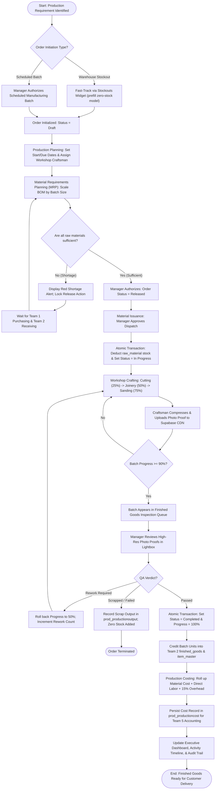
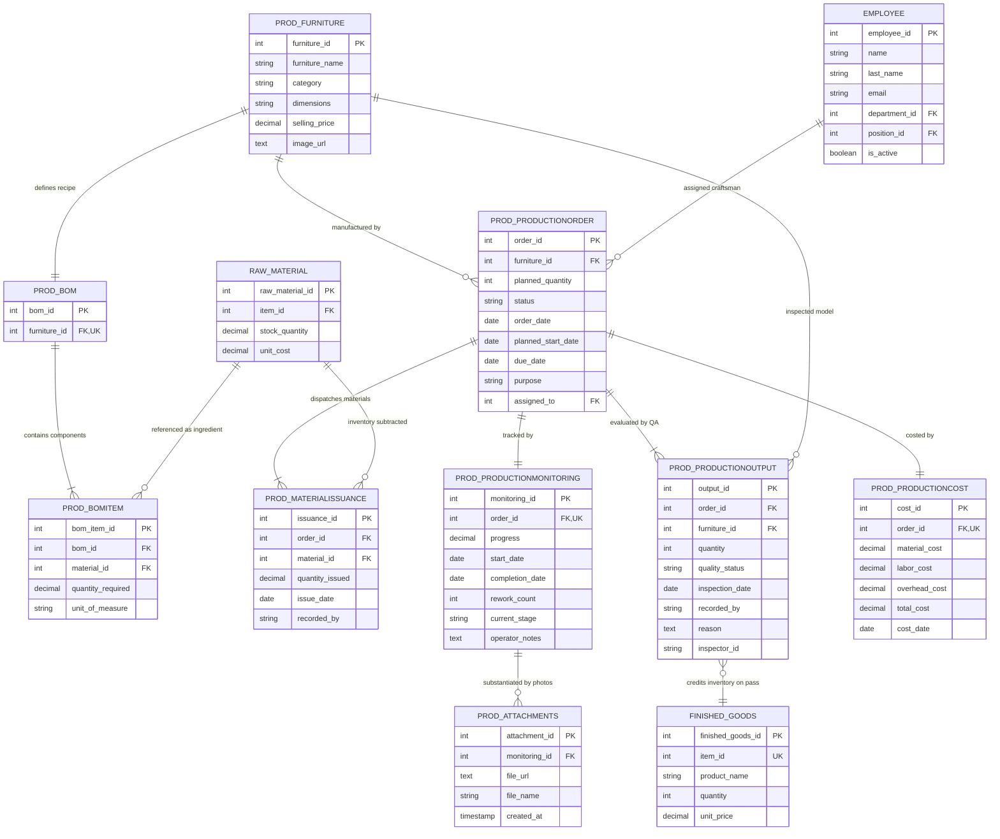

# Velmora Co. Production & Manufacturing ERP Module
## Software Engineering Documentation & Capstone Defense Specification
**System Module:** Production & Manufacturing (Team 3)  
**Enterprise Platform:** Velmora Co. ERP System  
**Document Version:** 2.0 (Defense Release)  
**Date:** October 2026  

---

## Table of Contents
1. [Module Description](#1-module-description)
2. [Objectives (General & Specific)](#2-objectives)
3. [Functional Requirements (FR)](#3-functional-requirements)
4. [Non-Functional Requirements (NFR)](#4-non-functional-requirements)
5. [Use Case Diagram & Actor Specifications](#5-use-case-diagram)
6. [System Operational Flowchart](#6-system-operational-flowchart)
7. [Entity-Relationship Diagram (ERD)](#7-entity-relationship-diagram-erd)
8. [Comprehensive Data Dictionary](#8-comprehensive-data-dictionary)

---

## 1. Module Description

The **Velmora Co. Production & Manufacturing Module** (Team 3) serves as the core operational execution engine of the Velmora Enterprise Resource Planning (ERP) platform. Designed specifically for batch furniture manufacturing and warehouse inventory replenishment, the system transforms production schedules and stockout alerts into verified finished goods inventory.

### Core Operational Scope
The module governs the full end-to-end manufacturing lifecycle:
1. **Product Master & Engineering Blueprints**: Centralizes furniture models, standard dimensions, technical specifications, and catalog selling prices.
2. **Bill of Materials (BOM) Formulation**: Establishes standard manufacturing recipes defining raw material consumption per 1 finished unit.
3. **Production Order Management**: Authorizes manufacturing batches originating from **Warehouse Restocking** (inventory replenishment) and **Scheduled Batches** (planned factory runs).
4. **Production Planning & Capacity Balancing**: Manages shop-floor scheduling, deadline tracking, workshop craftsman allocation, and real-time production health monitoring.
5. **Material Requirements Planning (MRP)**: Evaluates gross batch material demand against live warehouse inventory to detect shortages and block premature release.
6. **Material Issuance & Stock Deduction**: Decrements raw material stock from warehouse inventory in an atomic transaction upon dispatch to the workshop.
7. **Shop-Floor Monitoring & Photographic Proof**: Tracks physical build milestones (25%, 50%, 75%, 90%) with mandatory client-compressed photo proofs uploaded directly to Supabase Storage CDN.
8. **Quality Assurance (QA) Inspection Gating**: Evaluates completed batches at 90% build stage through visual lightbox proof inspections before approving automatic transfer into finished goods warehouse stock.
9. **Standard Job Costing**: Rolls up direct material expenditure, allocates workshop labor hours, applies standard 15% factory overhead, and publishes cost sheets to Accounting.
10. **Executive Analytics & Compliance Audit Trail**: Generates print-ready performance reports and maintains immutable audit logs of all inventory dispatches and QA decisions.

### Cross-Departmental Integration Boundary
The Production module communicates across dedicated interfaces to eliminate data silos:
* **Inventory & Warehousing (Team 2)**: Live bidirectional integration. Queries on-hand raw material availability (`public.raw_material`), decrements inventory atomically upon material issuance, monitors zero-stock finished goods stockouts to trigger replenishment batches, and credits completed products into warehouse stock (`public.finished_goods`) and shared catalog (`public.item_master`).
* **Finance & Accounting (Team 5)**: Outbound cost accounting integration. Commits audited job manufacturing costs into `public.prod_productioncost` for general ledger journalizing and COGS valuation.

*(Note: User authentication and workshop employee assignments operate directly on database tables `public.users` and `public.employee` with role-based checks for Department 6 personnel, with no external HR service or API integration).*

---

## 2. Objectives

### 2.1 General Objective
To design, develop, and implement an authoritative, robust, and automated Production & Manufacturing ERP module that streamlines the furniture manufacturing lifecycle, guarantees inventory synchronization, enforces quality standards, and tracks manufacturing costs within Velmora Co.

### 2.2 Specific Objectives
1. **Automate Engineering Recipe Formulation**: Provide a dynamic Bill of Materials (BOM) engine that calculates scaled raw material consumption from a 1-unit finished product standard.
2. **Eliminate Shop-Floor Bottlenecks**: Implement automated Material Requirements Planning (MRP) to verify warehouse inventory availability and flag component shortages before orders are released to the workshop.
3. **Guarantee Real-Time Inventory Integrity**: Execute atomic, ACID-compliant database transactions that decrement raw materials upon dispatch and credit finished goods upon quality approval without manual double-entry.
4. **Enforce Manufacturing Quality Standards**: Implement a Poka-Yoke 90% milestone gate requiring photographic proof of physical workmanship and independent Quality Assurance sign-off before inventory intake.
5. **Accredited Manufacturing Cost Accounting**: Automatically compute direct material expenditure, capture direct labor, apply standard 15% factory overhead, and export job cost records to Corporate Accounting.
6. **Enforce Enterprise Separation of Duties (SoD)**: Provide strict role-based access control (RBAC) ensuring floor craftsmen focus on assembly milestones while supervisory approvals, recipe costs, and financial analytics remain restricted to management.
7. **High-Performance Cloud Architecture**: Deliver sub-millisecond database socket reuse and in-memory catalog caching to eliminate cloud SSL handshake latency.

---

## 3. Functional Requirements (FR)

The functional requirements define the specific behaviors, business rules, inputs, and outputs of the system, indexed by exact UI tab label.

### 3.1 Authentication & Access Control (`/production/login`, `/production/logout`)
* **FR-AUTH-01 (Corporate Authentication)**: The system shall validate user credentials against `public.users` (using cryptographic password hash verification) and verify active employment in `public.employee`.
* **FR-AUTH-02 (Department Gatekeeping)**: The system shall strictly restrict login access to active personnel assigned to the **Production Department (`department_id = 6`)**. Personnel from other corporate departments shall be rejected.
* **FR-AUTH-03 (Role Resolution & Route Guarding)**: The system shall resolve user permissions based on `position_id`:
  * `position_id = 6`: Granted **Production Manager** authority (Full administrative CRUD, recipe costs, release gates, costing, reports).
  * `position_id = 2`: Granted **Production Staff** authority (Floor operations, progress updates, photo uploads; financial figures and cost columns stripped).
* **FR-AUTH-04 (Secure Sign Out)**: The system shall provide a sign-out mechanism that clears session credentials while preserving flash message queues and transmits `Cache-Control: no-store` to prevent back-button browser cache restoration.

### 3.2 Dashboard (`/production/`)
* **FR-DSH-01 (Executive KPI Cards)**: The system shall display aggregated counts of Active Batches, QC Passed Orders, Total Orders, and Low Stock inventory alerts.
* **FR-DSH-02 (Visual Stage Readiness)**: The system shall render real-time progress bars representing the percentage of active batches that have cleared each manufacturing workstation milestone.
* **FR-DSH-03 (Weekly Activity Bar Chart)**: The system shall render an interactive Monday-to-Sunday bar chart showing completed batch volume with week offset navigation (`<`, `>`).
* **FR-DSH-04 (Order Deadline Tracker)**: The system shall evaluate target completion dates against current time, flagging orders as `Overdue`, `Due Today`, or `This Week`.
* **FR-DSH-05 (Warehouse Stockouts Widget)**: The system shall query `public.finished_goods` where `stock_quantity = 0`, alerting managers to out-of-stock catalog models with direct restock links (Manager exclusive).
* **FR-DSH-06 (Live Activity Timeline)**: The system shall aggregate and display the 4 most recent operational events from the database (Order Registrations, Material Dispatches, Workstation Advancements, and QC Completions).

### 3.3 Product Master (`/production/furniture`)
* **FR-PRD-01 (Product Catalog Listing)**: The system shall list all registered furniture blueprints with dimensions, category, catalog selling price, and image previews.
* **FR-PRD-02 (Create Furniture Model)**: The system shall permit Production Managers to register new furniture models with input validation on positive prices and dimensions.
* **FR-PRD-03 (Edit & Delete Furniture Model)**: The system shall allow Production Managers to update catalog specifications or delete unreferenced furniture models.
* **FR-PRD-04 (Catalog Live Search & Filter)**: The system shall filter furniture cards in real time by name, category, or dimension criteria.

### 3.4 Bill of Materials - BOM (`/production/bom`)
* **FR-BOM-01 (Recipe Formulation)**: The system shall allow managers to initialize a manufacturing recipe linked to a furniture product based on a 1-finished-unit standard.
* **FR-BOM-02 (Component Line Item Management)**: The system shall permit managers to add raw material components, required quantities, and units of measure, or delete existing recipe items.
* **FR-BOM-03 (Standard Material Cost Rollup)**: The system shall calculate total standard recipe cost: $\sum (\text{BOM Item Quantity} \times \text{Raw Material Unit Price})$.
* **FR-BOM-04 (Confidential Cost Masking)**: The system shall automatically strip material unit costs, recipe cost totals, and profit margins when rendered for Production Staff.
* **FR-BOM-05 (Catalog Price Synchronization)**: The system shall calculate gross margin percentages based on recipe standard cost and allow managers to update `furniture.selling_price` directly.

### 3.5 Production Order (`/production/orders`)
* **FR-ORD-01 (Order Creation)**: The system shall authorize batch manufacturing orders with input fields for Target Product, Planned Batch Quantity, Planned Start Date, Target Due Date, and Operational Purpose (`'Warehouse Restock'` or `'Scheduled Batch'`).
* **FR-ORD-02 (Stockout Fast-Track Integration)**: When triggered from the Dashboard Warehouse Stockouts widget, the system shall pre-fill the product ID and automatically configure the purpose as `Warehouse Restock`.
* **FR-ORD-03 (Draft Order Lifecycle & Safety Guards)**: The system shall permit modification and safe deletion of orders while in `Draft` status; once materials are issued or status advances, order deletion shall be blocked to maintain data integrity.
* **FR-ORD-04 (Order Status Tracking)**: The system shall enforce strict state transitions across `Draft` &rarr; `Released` &rarr; `In Progress` &rarr; `Completed`.
* **FR-ORD-05 (Production Order Dossier)**: The system shall render a comprehensive batch dossier (`/production/orders/<id>`) detailing planned timelines, assigned staff, material stock readiness, and chronological activity logs.

### 3.6 Production Planning (`/production/planning`)
* **FR-PLN-01 (Timeline Scheduling & Staff Assignment)**: The system shall allow managers to assign Planned Start Dates, Target Due Dates, and allocate Department 6 workshop craftsmen.
* **FR-PLN-02 (Live Workload Display)**: The staff selection dropdown shall display the active batch count currently assigned to each craftsman to prevent operator bottlenecking.
* **FR-PLN-03 (Dynamic Health Status Evaluation)**: The system shall classify each batch's operational health:
  * `Needs Plan`: Dates unassigned.
  * `On Schedule`: Current date within planned boundaries.
  * `Overdue`: Incomplete batch where current date exceeds target deadline.
  * `Completed`: Batch has cleared QA inspection.
* **FR-PLN-04 (Gantt Calendar Timeline View)**: The system shall transform order schedules into an interactive horizontal Gantt calendar view.

### 3.7 Material Requirement (`/production/requirement`)
* **FR-MRP-01 (MRP Scaling Calculation)**: The system shall compute gross material demand: $\text{Required Qty} = \text{BOM Item Qty} \times \text{Batch Quantity}$.
* **FR-MRP-02 (Warehouse Availability Comparison)**: The system shall compare required quantities against live warehouse inventory in `public.raw_material.stock_quantity`.
* **FR-MRP-03 (Shortage Deficit Alerting)**: The system shall flag components with insufficient stock, displaying exact shortfall quantities in red warning badges.
* **FR-MRP-04 (Release Authorization Gate)**: The system shall lock the "Release to Floor" action until all required materials are verified available in warehouse inventory.

### 3.8 Material Issuance (`/production/issuance`)
* **FR-ISS-01 (Material Dispatch Approval)**: The system shall permit managers to approve material dispatch for orders in `Released` status.
* **FR-ISS-02 (Atomic Warehouse Inventory Deduction)**: Upon dispatch approval, the system shall execute an atomic transaction that:
  1. Decrements required quantities from `public.raw_material.stock_quantity`.
  2. Inserts immutable audit records into `public.prod_materialissuance`.
  3. Initializes the progress monitoring record at `0.0%`.
  4. Transitions order status from `Released` to `In Progress`.

### 3.9 Production Monitoring (`/production/monitoring`)
* **FR-MON-01 (Milestone Progress Logging)**: The system shall allow craftsmen to log workstation milestone progress: Cutting (25%), Joinery (50%), Sanding (75%), and Ready for QA (90%).
* **FR-MON-02 (Client-Side Photo Optimization)**: The system shall resize and compress uploaded stage photos in the browser using HTML5 Canvas (max 1280px, 82% JPEG quality) prior to transmission.
* **FR-MON-03 (Cloud Photo Proof Storage)**: The system shall upload stage photos to Supabase Storage CDN (`prod-attachments` bucket) and record public CDN URLs in `public.prod_attachments`.
* **FR-MON-04 (Floor Rework Logging)**: The system shall allow operators to flag orders for rework (max 2 cycles), alerting supervisors and recording remediation notes.

### 3.10 Finished Goods & Quality Assurance (`/production/finished-goods`)
* **FR-QA-01 (QA Gatekeeper Unlock)**: The system shall unlock Quality Inspection actions exclusively when a batch reaches the 90% build milestone.
* **FR-QA-02 (Photo Proof Lightbox Viewer)**: The system shall provide an interactive image lightbox allowing inspectors to examine high-resolution stage photos before recording decisions.
* **FR-QA-03 (QA Decision: Passed)**: When approved, the system shall elevate progress to 100%, set order status to `Completed`, log a QA record in `public.prod_productionoutput`, and credit finished units into `public.finished_goods` via an atomic SQL upsert.
* **FR-QA-04 (QA Decision: Rework)**: When rework is required, the system shall roll back floor progress to 50% (Joinery & Assembly), increment the rework counter, and return the batch to the workshop.
* **FR-QA-05 (QA Decision: Scrapped)**: When scrapped, the system shall record total batch failure in `public.prod_productionoutput` without adding warehouse stock.

### 3.11 Production Costing (`/production/costing`) [Manager Exclusive]
* **FR-CST-01 (Direct Material Cost Rollup)**: The system shall compute actual direct material cost from quantities recorded in `public.prod_materialissuance` and unit costs in `public.raw_material`.
* **FR-CST-02 (Direct Labor & Factory Overhead Calculation)**: The system shall compute labor cost ($\text{Hours} \times \text{Rate}$), apply standard 15% factory overhead ($\text{Overhead} = 0.15 \times (\text{Material} + \text{Labor})$), and compute total batch manufacturing cost.
* **FR-CST-03 (General Ledger Export)**: The system shall persist finalized cost sheets into `public.prod_productioncost` with a UNIQUE constraint on `order_id` for Corporate Accounting synchronization.

### 3.12 Production Reports & Auditing (`/production/reports`) [Manager Exclusive]
* **FR-REP-01 (Executive Performance Analytics)**: The system shall compute factory fulfillment rates, completion percentages, average cycle times, and scrap rates.
* **FR-REP-02 (Material Consumption & Variance Analysis)**: The system shall compare planned standard BOM consumption against actual dispatched quantities to detect manufacturing waste.
* **FR-REP-03 (System Audit Trail)**: The system shall provide an immutable, paginated transaction log capturing all material issuances and QA inspection handoffs (Who, What, When, Order ID).
* **FR-REP-04 (Print / PDF Export)**: The system shall format executive reports via print-optimized stylesheets (`@media print`) that suppress sidebars and navigation controls.

---

## 4. Non-Functional Requirements (NFR)

### 4.1 Performance & Latency
* **NFR-PERF-01 (Database Connection Pooling)**: The system shall maintain persistent pre-authenticated database sockets via `ThreadedConnectionPool(minconn=1, maxconn=10)`. Request-scoped checkout latency shall not exceed 1 millisecond.
* **NFR-PERF-02 (In-Memory Micro-Caching)**: Master catalog reads (`Furniture`, `Material`) shall be served from an in-memory thread-safe cache with 0ms retrieval times.
* **NFR-PERF-03 (N+1 Query Elimination)**: The MRP engine shall pre-load inventory records into an in-memory hash map, guaranteeing $O(1)$ component stock evaluation.

### 4.2 Security & Integrity
* **NFR-SEC-01 (Cryptographic Hashing)**: Passwords shall be cryptographically hashed using industry-standard bcrypt / PBKDF2 algorithms. Plaintext passwords shall never be stored or logged.
* **NFR-SEC-02 (Role-Based Route Decorators)**: All administrative mutating routes shall be protected by server-side `@manager_required` decorators, halting unauthorized access attempts with HTTP 302 redirects.
* **NFR-SEC-03 (Cache-Control Headers)**: HTML responses shall transmit `Cache-Control: no-store, no-cache, must-revalidate` to prevent browser history caching after logout.
* **NFR-SEC-04 (Separation of Duties)**: Unit material costs, profit margins, and financial reports shall be masked from floor staff across all views.

### 4.3 Data Integrity & Transaction Safety
* **NFR-REL-01 (ACID Transaction Atomicity)**: All multi-table mutations (material issuance, inventory stock deduction, QA stock crediting) shall execute inside atomic transactions (`with openTransaction() as conn:`). Any failure shall trigger a complete rollback.
* **NFR-REL-02 (Non-Negative Stock Constraints)**: Inventory deduction SQL shall enforce conditional matching (`AND stock_quantity >= %s`) to prevent negative warehouse inventory balances.

### 4.4 Usability & Responsiveness
* **NFR-USE-01 (Responsive Viewport Adaptation)**: The user interface shall adapt across mobile ($360\text{px}\text{--}768\text{px}$) and desktop ($>768\text{px}$) viewports via scoped CSS media queries.
* **NFR-USE-02 (Touch-Momentum Table Scrolling)**: All tabular data containers shall support native touch-momentum horizontal swiping (`-webkit-overflow-scrolling: touch`) on mobile devices.
* **NFR-USE-03 (Poka-Yoke Error Proofing)**: Destructive and irreversible operations (order deletion, QA rejection, inventory issuance) shall require deliberate modal confirmation.

---

## 5. Use Case Diagram

### 5.1 Use Case Specifications
* **Primary Human Actors**:
  * **Production Manager (`Position 6`)**: Oversees blueprints, BOM recipes, scheduling, material releases, QA inspections, job costing, and reporting.
  * **Production Staff (`Position 2`)**: Floor craftsmen who view assigned orders, log milestone progress, and upload photo proofs.
* **Secondary / External System Actors**:
  * **Inventory System (Team 2)**: Supplies raw material stock data, zero-stock stockout alerts, and receives finished goods.
  * **Accounting System (Team 5)**: Consumes finalized job manufacturing cost sheets.

```mermaid
flowchart LR
    subgraph Actors
        PM["Production Manager (Position 6)"]
        PS["Production Staff (Position 2)"]
        INV["Team 2: Inventory System"]
        ACC["Team 5: Accounting System"]
    end

    subgraph Production_ERP["Velmora Production ERP Module"]
        UC01["Authenticate & Session Gate"]
        UC02["Manage Furniture Catalog"]
        UC03["Configure Bill of Materials (BOM)"]
        UC04["Create Production Order (Restock / Scheduled)"]
        UC05["Schedule Batch & Assign Staff"]
        UC06["Verify Material Availability (MRP)"]
        UC07["Authorize & Release Order"]
        UC08["Dispatch Materials & Deduct Stock"]
        UC09["Update Workshop Milestone Progress"]
        UC10["Upload Cloud Photo Proof"]
        UC11["Inspect Batch (QA Decision)"]
        UC12["Calculate Job Cost (Material+Labor+Overhead)"]
        UC13["Export Reports & Audit Logs"]
    end

    PM --> UC01
    PM --> UC02
    PM --> UC03
    PM --> UC04
    PM --> UC05
    PM --> UC06
    PM --> UC07
    PM --> UC08
    PM --> UC11
    PM --> UC12
    PM --> UC13

    PS --> UC01
    PS --> UC09
    PS --> UC10

    UC04 <.. INV : "Stockout Restock Alerts"
    UC06 <.. INV : "Query Raw Materials"
    UC08 ..> INV : "Deduct Raw Materials"
    UC11 ..> INV : "Credit Finished Goods"
    UC12 ..> ACC : "Publish Cost Sheet"
```

---

## 6. System Operational Flowchart

The operational flowchart illustrates the complete 8-step manufacturing lifecycle across departments and system gates.



---

## 7. Entity-Relationship Diagram (ERD)

The ERD documents the structural relationships between internal Production module tables and shared external enterprise tables.



---

## 8. Comprehensive Data Dictionary

The data dictionary provides technical descriptions, data types, constraints, and operational purposes for all tables managed by the Production module.

### 8.1 Table: `public.prod_furniture`
**Description:** Central product engineering catalog defining finished furniture models manufactured by Team 3.

| Column Name | Data Type | Nullable | Constraints | Description |
| :--- | :--- | :---: | :--- | :--- |
| `furniture_id` | SERIAL | NO | PRIMARY KEY | Unique auto-incrementing furniture blueprint identifier. |
| `furniture_name` | VARCHAR(150) | NO | NOT NULL | Commercial model name (e.g., Dining Chair, Oak Desk). |
| `category` | VARCHAR(50) | NO | NOT NULL | Product grouping: `Seating`, `Tables`, `Storage`, `Beds`, `Custom`. |
| `dimensions` | VARCHAR(100) | YES | - | Physical engineering dimensions (Length x Width x Height in cm/inches). |
| `selling_price` | NUMERIC(10,2) | NO | CHECK $\ge 0.00$ | Suggested retail catalog selling price. |
| `image_url` | TEXT | YES | - | Public URL reference to visual product catalog photography. |

---

### 8.2 Table: `public.prod_bom`
**Description:** Authoritative master recipe header defining the bill of materials for a furniture piece based on a 1-unit finished standard.

| Column Name | Data Type | Nullable | Constraints | Description |
| :--- | :--- | :---: | :--- | :--- |
| `bom_id` | SERIAL | NO | PRIMARY KEY | Unique manufacturing recipe header identifier. |
| `furniture_id` | INT | NO | UNIQUE, FK &rarr; `prod_furniture(furniture_id)` | Foreign key enforcing exactly 1 active BOM recipe per furniture model. |

---

### 8.3 Table: `public.prod_bomitem`
**Description:** Line item specifications detailing raw material ingredients consumed per finished unit.

| Column Name | Data Type | Nullable | Constraints | Description |
| :--- | :--- | :---: | :--- | :--- |
| `bom_item_id` | SERIAL | NO | PRIMARY KEY | Unique BOM ingredient line item identifier. |
| `bom_id` | INT | NO | FK &rarr; `prod_bom(bom_id)` ON DELETE CASCADE | Parent Bill of Materials recipe reference. |
| `material_id` | INT | NO | FK &rarr; `raw_material(raw_material_id)` | Raw material ingredient consumed from Team 2 inventory. |
| `quantity_required` | NUMERIC(10,2) | NO | CHECK $> 0.00$ | Physical quantity consumed to build 1 finished furniture unit. |
| `unit_of_measure` | VARCHAR(30) | YES | - | Consumption unit metric (e.g., board ft, pcs, meters, kg). |

---

### 8.4 Table: `public.prod_productionorder`
**Description:** Primary transactional document authorizing and scheduling batch furniture production.

| Column Name | Data Type | Nullable | Constraints | Description |
| :--- | :--- | :---: | :--- | :--- |
| `order_id` | SERIAL | NO | PRIMARY KEY | Unique production order tracking reference (`#PO-XXX`). |
| `furniture_id` | INT | NO | FK &rarr; `prod_furniture(furniture_id)` | Target furniture model being manufactured. |
| `planned_quantity` | INT | NO | CHECK $> 0$ | Total batch volume to manufacture. |
| `status` | VARCHAR(30) | NO | DEFAULT `'Draft'` | Lifecycle state: `Draft`, `Released`, `In Progress`, `Completed`, `Cancelled`. |
| `order_date` | DATE | NO | DEFAULT `CURRENT_DATE` | Date when the production order was registered. |
| `planned_start_date` | DATE | YES | - | Scheduled date when workshop assembly is slated to begin. |
| `due_date` | DATE | YES | - | Target completion and workshop delivery deadline. |
| `purpose` | VARCHAR(50) | NO | DEFAULT `'Warehouse Restock'` | Manufacturing purpose: `'Warehouse Restock'` (inventory buffer replenishment) or `'Scheduled Batch'` (planned production run). |
| `assigned_to` | INT | YES | FK &rarr; `employee(employee_id)` | Assigned Department 6 craftsman responsible for the batch. |

---

### 8.5 Table: `public.prod_materialissuance`
**Description:** Immutable audit ledger recording raw materials dispatched from warehouse inventory to released orders.

| Column Name | Data Type | Nullable | Constraints | Description |
| :--- | :--- | :---: | :--- | :--- |
| `issuance_id` | SERIAL | NO | PRIMARY KEY | Unique material dispatch voucher identifier (`#IS-XXX`). |
| `order_id` | INT | NO | FK &rarr; `prod_productionorder(order_id)` | Production order receiving the raw materials. |
| `material_id` | INT | NO | FK &rarr; `raw_material(raw_material_id)` | Raw material inventory item dispatched. |
| `quantity_issued` | NUMERIC(10,2) | NO | CHECK $> 0.00$ | Actual physical quantity deducted from warehouse stock. |
| `issue_date` | DATE | NO | DEFAULT `CURRENT_DATE` | Timestamp date of physical warehouse dispatch. |
| `recorded_by` | VARCHAR(100) | NO | - | Full name of authorized manager who approved the dispatch. |

---

### 8.6 Table: `public.prod_productionmonitoring`
**Description:** Real-time shop-floor tracking record monitoring physical build progress across workstation milestones.

| Column Name | Data Type | Nullable | Constraints | Description |
| :--- | :--- | :---: | :--- | :--- |
| `monitoring_id` | SERIAL | NO | PRIMARY KEY | Unique workshop monitoring record identifier. |
| `order_id` | INT | NO | UNIQUE, FK &rarr; `prod_productionorder(order_id)` | 1-to-1 link to active production order. |
| `progress` | NUMERIC(5,2) | NO | DEFAULT `0.00`, CHECK $0 \le x \le 100$ | Current completion milestone percentage (25%, 50%, 75%, 90%, 100%). |
| `start_date` | DATE | YES | DEFAULT `CURRENT_DATE` | Date when physical assembly officially commenced. |
| `completion_date` | DATE | YES | - | Date when batch reached 100% and cleared QA inspection. |
| `rework_count` | INT | NO | DEFAULT `0` | Number of remediation rework cycles logged (capped at 2). |
| `current_stage` | VARCHAR(100) | YES | - | Active workstation label (e.g., Cutting, Framing, Assembly, Sanding). |
| `operator_notes` | TEXT | YES | - | Operational logs and remarks recorded by craftsmen. |

---

### 8.7 Table: `public.prod_attachments`
**Description:** Digital repository of photo proofs substantiating physical build completion at each workstation.

| Column Name | Data Type | Nullable | Constraints | Description |
| :--- | :--- | :---: | :--- | :--- |
| `attachment_id` | SERIAL | NO | PRIMARY KEY | Unique photo attachment identifier. |
| `monitoring_id` | INT | NO | FK &rarr; `prod_productionmonitoring(monitoring_id)` | Parent monitoring record associated with the photo proof. |
| `file_url` | TEXT | NO | NOT NULL | Public Supabase Storage CDN URL for visual lightbox inspection. |
| `file_name` | VARCHAR(255) | YES | - | Original uploaded file name from mobile or desktop device. |
| `created_at` | TIMESTAMP | NO | DEFAULT `CURRENT_TIMESTAMP` | System timestamp when photo proof was uploaded. |

---

### 8.8 Table: `public.prod_productionoutput`
**Description:** Authoritative Quality Assurance (QA) inspection records evaluating completed furniture batches.

| Column Name | Data Type | Nullable | Constraints | Description |
| :--- | :--- | :---: | :--- | :--- |
| `output_id` | SERIAL | NO | PRIMARY KEY | Unique quality inspection evaluation identifier (`#QA-XXX`). |
| `order_id` | INT | NO | FK &rarr; `prod_productionorder(order_id)` | Production order evaluated by QA. |
| `furniture_id` | INT | NO | FK &rarr; `prod_furniture(furniture_id)` | Model of furniture inspected. |
| `quantity` | INT | NO | CHECK $\ge 0$ | Number of finished units inspected. |
| `quality_status` | VARCHAR(30) | NO | NOT NULL | Final inspection outcome: `Passed`, `Rework`, `Failed`. |
| `inspection_date` | DATE | NO | DEFAULT `CURRENT_DATE` | Date when QA inspection was performed. |
| `recorded_by` | VARCHAR(100) | NO | - | Full name of the quality inspector / manager. |
| `reason` | TEXT | YES | - | Defect explanation or inspection sign-off remarks. |
| `inspector_id` | VARCHAR(50) | YES | - | Corporate employee ID of the inspector. |

---

### 8.9 Table: `public.prod_productioncost`
**Description:** Authoritative manufacturing cost sheet published for Corporate Accounting (Team 5) general ledger integration.

| Column Name | Data Type | Nullable | Constraints | Description |
| :--- | :--- | :---: | :--- | :--- |
| `cost_id` | SERIAL | NO | PRIMARY KEY | Unique cost sheet identifier (`#CST-XXX`). |
| `order_id` | INT | NO | UNIQUE, FK &rarr; `prod_productionorder(order_id)` | Enforces strict 1-to-1 job order costing integrity. |
| `material_cost` | NUMERIC(12,2) | NO | CHECK $\ge 0.00$ | Actual direct material expense rolled up from `prod_materialissuance`. |
| `labor_cost` | NUMERIC(12,2) | NO | CHECK $\ge 0.00$ | Direct workshop carpentry labor allocated to the batch. |
| `overhead_cost` | NUMERIC(12,2) | NO | CHECK $\ge 0.00$ | Standard 15% factory overhead ($0.15 \times (\text{Material} + \text{Labor})$). |
| `total_cost` | NUMERIC(12,2) | NO | CHECK $\ge 0.00$ | Total batch manufacturing investment ($\text{Material} + \text{Labor} + \text{Overhead}$). |
| `cost_date` | DATE | NO | DEFAULT `CURRENT_DATE` | Date when the job cost sheet was finalized. |

